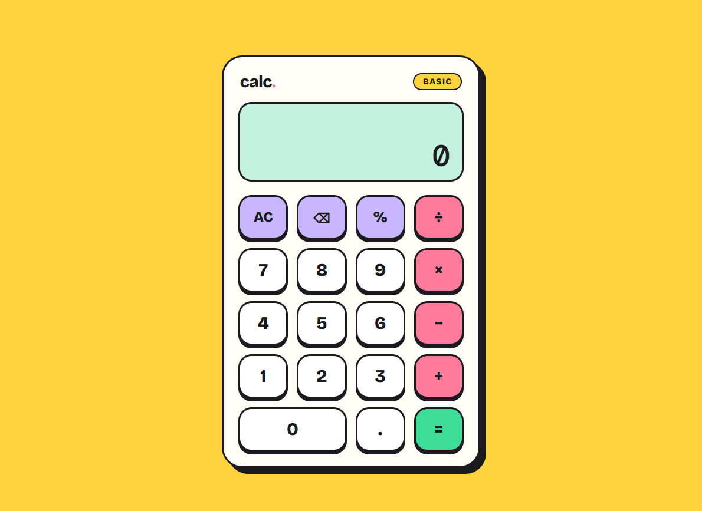

# 🧮 Calc. — Modern Calculator

A stylish and responsive calculator built with HTML, CSS, and JavaScript. Featuring a colorful UI, smooth interactions, and keyboard support for a better calculation experience.

## 🚀 Live Demo

🔗 **Live Website:** [Click Here](https://calculater-nine-phi.vercel.app/)

## 📸 Preview

## ✨ Features

- ➕ Addition, subtraction, multiplication, and division
- 📊 Percentage calculations
- ⌨️ Keyboard support
- 🗑️ Clear all and delete last input
- 🎯 Correct arithmetic operator precedence
- 🚫 Division-by-zero error handling
- 📱 Responsive design for mobile screens
- 🎨 Modern UI with colorful buttons
- 🔢 Automatic text resizing for long expressions
- ⚡ Lightweight and fast performance

## 🛠️ Technologies Used

- HTML5
- CSS3
- JavaScript
- Google Fonts

## 🎨 Design

- Bright yellow background
- Mint-green calculator display
- Pastel purple function buttons
- Pink operator buttons
- Green equals button
- Bold borders and playful shadows

⭐ If you like this project, give the repository a star!

**Made with ❤️ using HTML, CSS & JavaScript.**
